# Proyecto integrador TOPW · React + Vite + Supabase

Aplicación web con **4 módulos**: Clima, Películas, Países y Star Wars. Los datos se obtienen de APIs públicas, se guardan en una base de datos de **Supabase** y la interfaz, hecha con **React + Vite**, los consulta **solo desde ahí**. El acceso es mediante **OAuth con GitHub**.

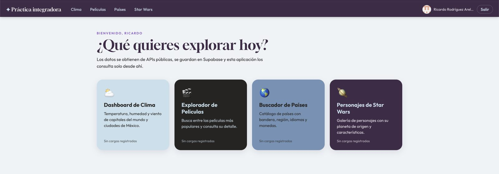

---

## Contenido
1. [Capturas](#capturas)
2. [Cómo se cumplen las instrucciones](#cómo-se-cumplen-las-instrucciones)
3. [Mejoras extra (lo que no se pidió)](#mejoras-extra-lo-que-no-se-pidió)
4. [Arquitectura](#arquitectura)
5. [Puesta en marcha](#puesta-en-marcha)
6. [Problemas que resolvimos en el camino](#problemas-que-resolvimos-en-el-camino)
7. [Problemas comunes](#problemas-comunes)

---

## Capturas

### Inicio de sesión (OAuth)
<p align="center"></p>

### Dashboard de Clima
El fondo cambia según el clima real de la ciudad seleccionada. Aquí la Ciudad de México con lluvia ligera: nubes grises y gotas cayendo.

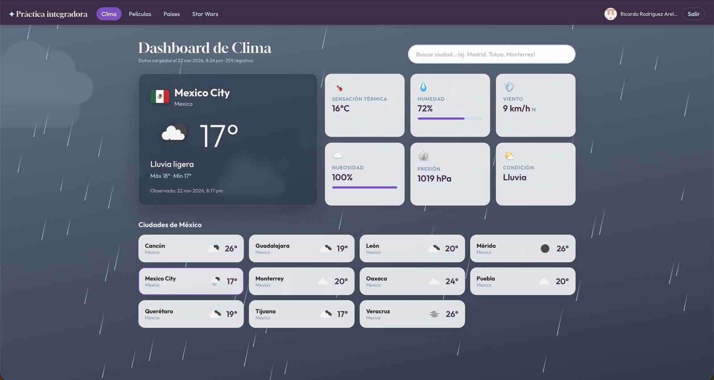

| Búsqueda por ciudad | |
|---|---|
| 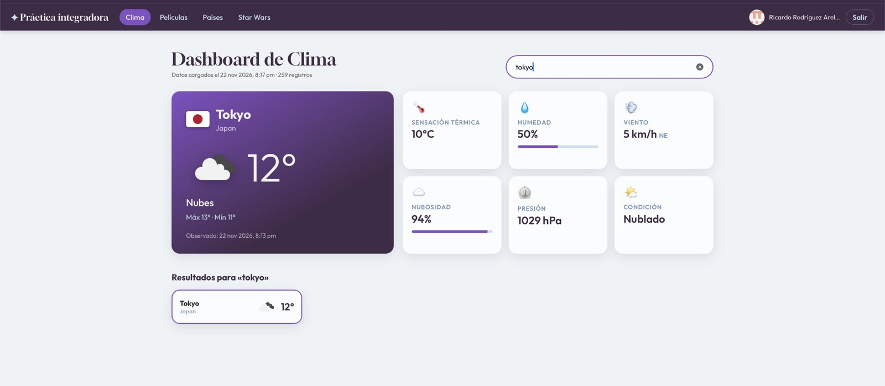 | Se busca **en la base de datos** (no en la API). Si la ciudad no existe, se muestra un mensaje de error amigable. |

### Explorador de Películas
| Banner con la película más popular | Galería con paginación |
|---|---|
|  | 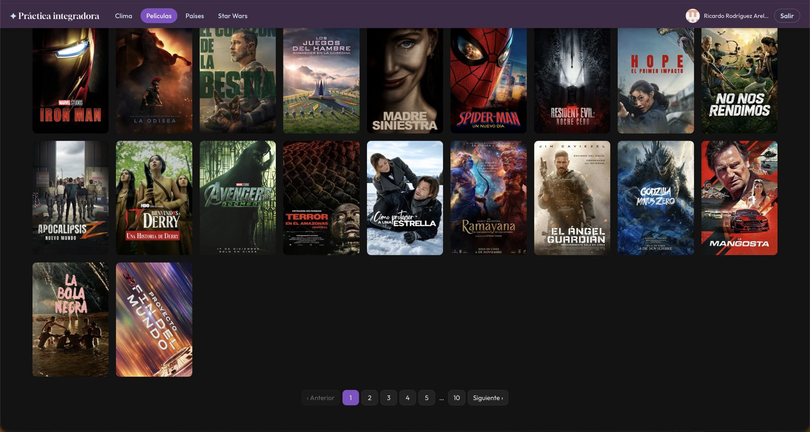 |


### Buscador de Países
| Catálogo | Filtro por región |
|---|---|
| 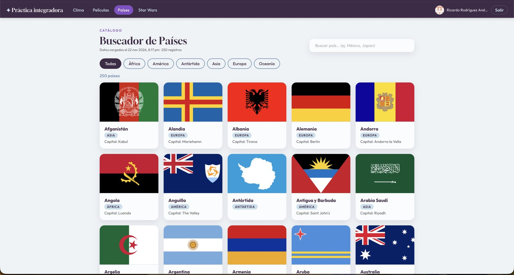 | 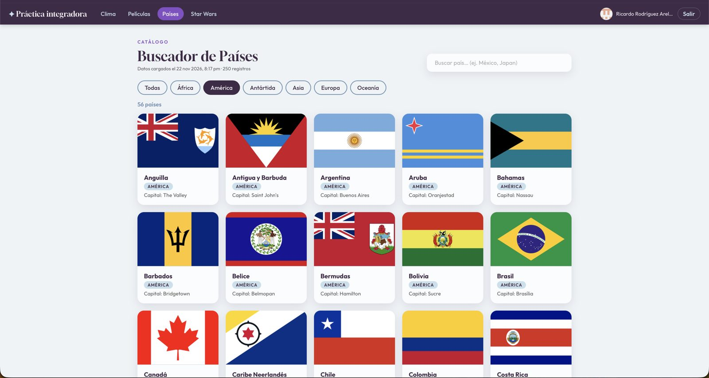 |

| Bandera ondeando en el panel lateral | Países vecinos (se pueden abrir) |
|---|---|
| 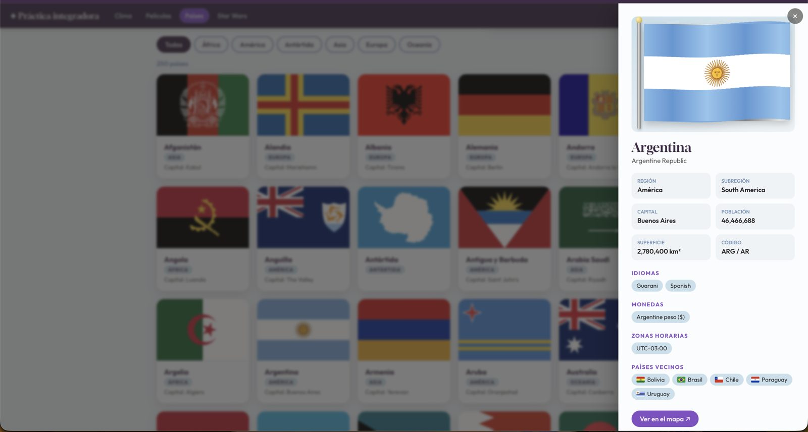 | 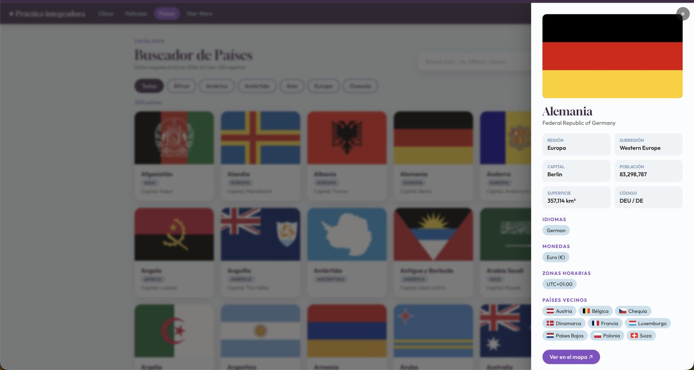 |

### Personajes de Star Wars
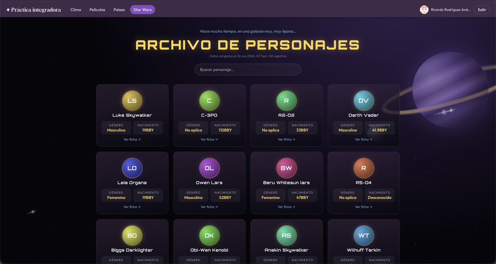

| Holograma 3D (frente) | Holograma 3D (reverso) |
|---|---|
| 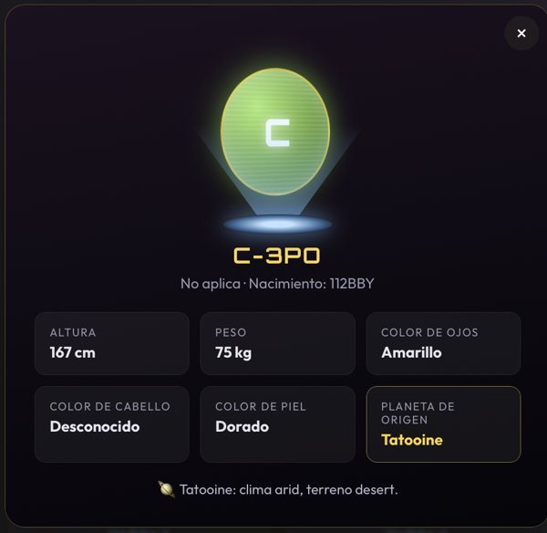 | 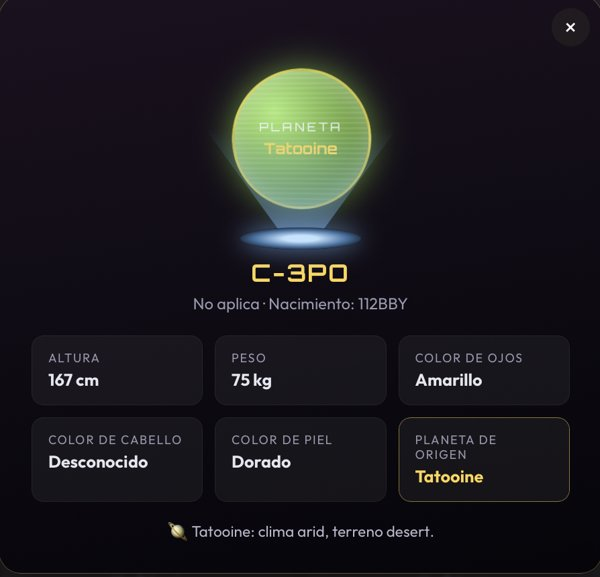 |

### Proceso de carga (backend)
<p align="center">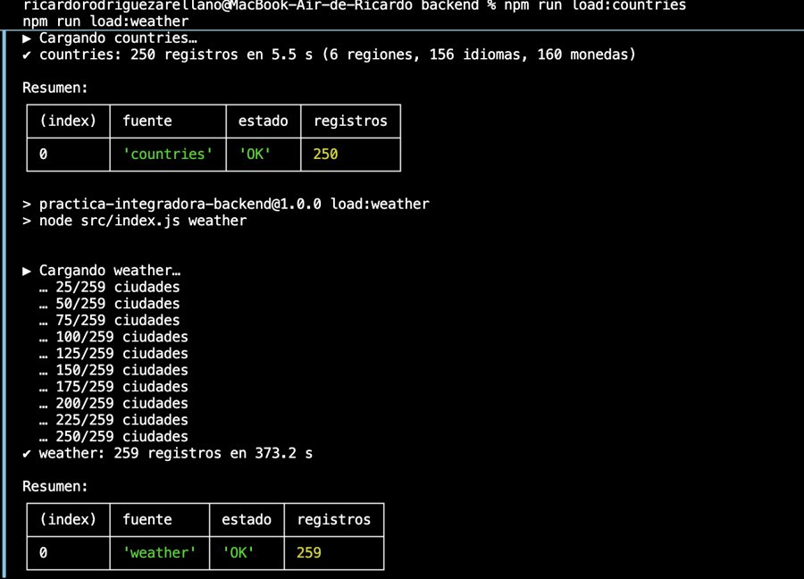</p>

---

## Cómo se cumplen las instrucciones

| Instrucción | Cómo se cumple |
|---|---|
| 1. Autenticación OAuth | Supabase Auth con **GitHub** (`frontend/src/context/AuthContext.jsx`). Todas las rutas están protegidas y sin sesión se redirige al login. |
| 2. Obtención de datos públicos | `backend/src/loaders/*`: se consultan múltiples registros, se recorre la **paginación** (SWAPI, TMDb y REST Countries) y se **manejan errores** con reintentos, tiempo límite, servidor espejo para SWAPI y errores por ciudad en el clima. |
| 3. Persistencia | `supabase/schema.sql`: tablas **normalizadas** (catálogos de regiones, subregiones, idiomas, monedas, géneros, planetas y condiciones del clima, con tablas puente), llaves primarias y foráneas, `unique` y `check` para la **consistencia**. |
| 4. Proceso de carga | `npm run load` en `backend/`: API pública → Supabase con *upsert* (no duplica datos) y bitácora en la tabla `etl_runs`. |
| 5. Consumo solo de la base | El frontend usa **únicamente** Supabase (`frontend/src/services/api.js`), a través de **vistas** que funcionan como "API propia". Nunca llama a las APIs públicas. |
| 6. Interfaz con React + Vite | 4 pantallas con el diseño que pide cada práctica: tarjetas, *responsive*, indicadores de carga, modales, panel lateral, paginación y animaciones. |

| Módulo | Fuente | Requerimientos cubiertos |
|---|---|---|
| Clima | OpenWeather | Búsqueda por ciudad · temperatura, clima, humedad y viento · ícono · manejo de errores · dashboard con tarjetas · *responsive* · indicador de carga |
| Películas | TMDb | Buscador · título, póster y año · vista de detalle · paginación · diseño oscuro tipo *streaming* · grid de tarjetas · animaciones · barra de búsqueda |
| Países | REST Countries v5 | Búsqueda · bandera, nombre y región · vista de detalle · filtro por región · catálogo · tarjetas · panel lateral |
| Star Wars | SWAPI | Listado · nombre, género y año de nacimiento · detalle con altura, peso, ojos, cabello y planeta · paginación · tema espacial · galería · modal · indicador de carga |

---

## Mejoras extra (lo que no se pidió)

### 1. Clima: fondo animado según el clima real
Toda la pantalla cambia de color y animación según la **condición**, la **hora** (día o noche, según el ícono de OpenWeather), la **temperatura** y el **viento** de la ciudad seleccionada. La tarjeta principal es de vidrio esmerilado para que la animación se vea detrás.

| Clima | Lo que se ve |
|---|---|
| ☀️ Soleado | Fondo naranja, sol que brilla y rayos girando |
| 🔥 Calor (≥ 30 °C) | Tonos rojizos y efecto de aire caliente |
| 🌙 Noche despejada | Azul profundo, luna y estrellas que titilan |
| ☁️ Nublado | Gris claro con nubes que cruzan |
| 🌧️ Lluvia / llovizna | Gris azulado, nubes oscuras y gotas cayendo en diagonal |
| ⛈️ Tormenta | Casi negro, lluvia intensa y un relámpago cada 8 s |
| ❄️ Nieve | Blanco azulado con copos que caen meciéndose |
| 🌫️ Neblina, bruma o humo | Bancos de niebla en movimiento |
| 🌬️ Frío (< 12 °C) o viento ≥ 25 km/h | Se suman ráfagas de aire cruzando la pantalla |

Archivos: `frontend/src/components/WeatherScene.jsx` y `frontend/src/styles/weather.css`.

### 2. Países: bandera que ondea
Al abrir un país, su bandera aparece en un asta y **ondea**. La imagen se corta en 32 tiras verticales que suben y bajan con un pequeño desfase, con más movimiento lejos del asta. Encima, una capa de luces y sombras se desplaza para simular los pliegues de la tela. Funciona con cualquier bandera porque usa la imagen guardada en la base.

Archivos: `frontend/src/components/FlagWave.jsx` y `frontend/src/styles/countries.css`.

### 3. Star Wars: escena espacial y holograma 3D
- **Fondo:** un planeta con anillos que gira lentamente, una luna flotando, **naves en órbita** que pasan por delante y por detrás del planeta, y otras naves cruzando la pantalla. Todos los diseños son **originales**, no pertenecen a la saga.
- **Ficha del personaje:** en lugar de una foto, una **medalla holográfica 3D** que gira sobre un proyector. Al frente muestra las iniciales y atrás el planeta de origen, con líneas de escaneo y un ligero parpadeo de holograma.

Archivos: `frontend/src/pages/StarWars.jsx` y `frontend/src/styles/starwars.css`.

### 4. Otros detalles
- **Diseño propio por módulo** con una paleta común (Pale Sky, Dusty Denim, Deep Lilac, Midnight Violet y Shadow Grey).
- **Datos en español:** condiciones del clima, géneros de personajes y colores de ojos, cabello y piel se traducen en pantalla. Los países se muestran con su nombre en español.
- **"Datos cargados el…"** en cada módulo, leído de la bitácora `etl_runs`, para saber qué tan actualizada está la información.
- **Países vecinos navegables:** desde el panel de un país puedes saltar a sus vecinos.
- **Banner destacado** con la película más popular y filtro por **género**.
- **Búsqueda con retardo (*debounce*):** no se consulta la base en cada tecla.
- **Accesibilidad:** si el sistema tiene activado *Reducir movimiento*, las animaciones se desactivan. Los modales se cierran con `Esc`.
- **Menú *responsive*** con botón de hamburguesa en pantallas pequeñas.

---

## Arquitectura

```
API pública ──► backend (Node, ETL) ──► Supabase (PostgreSQL + RLS) ──► frontend (React + Vite)
                 service role key                vistas/REST            anon key + sesión OAuth
```

```
├── supabase/schema.sql        # tablas, vistas, índices, permisos y seguridad (RLS)
├── backend/                   # proceso de carga (Node 18+)
│   ├── src/index.js           # CLI: all | countries | starwars | movies | weather
│   ├── src/lib/               # cliente Supabase, fetch con reintentos, bitácora
│   └── src/loaders/           # un cargador por API
├── frontend/                  # React + Vite
│   └── src/
│       ├── services/api.js    # todas las consultas (solo Supabase)
│       ├── context/           # sesión OAuth
│       ├── components/        # Loader, Modal, Pagination, WeatherScene, FlagWave…
│       ├── pages/             # Login, Home, Weather, Movies, Countries, StarWars
│       └── styles/
└── docs/capturas/             # imágenes de este README
```

**Seguridad**
- **RLS activado en todas las tablas:** solo los usuarios autenticados pueden **leer** y nadie puede escribir desde el navegador.
- La **service role key** solo vive en `backend/.env`. Los archivos `.env` están excluidos en `.gitignore`.

---

## Puesta en marcha

### 1. Supabase
1. Crea un proyecto en <https://supabase.com>.
2. En **SQL Editor → New query**, pega todo `supabase/schema.sql` y presiona **Run**.
3. En **Project Settings → API** copia la **Project URL**, la **anon / publishable key** (frontend) y la **service_role / secret key** (backend).

### 2. OAuth con GitHub
1. En GitHub: **Settings → Developer settings → OAuth Apps → New OAuth App**.
   - *Homepage URL*: `http://localhost:5173`
   - *Authorization callback URL*: `https://TU-PROYECTO.supabase.co/auth/v1/callback`
2. Copia el **Client ID** y genera un **Client Secret**.
3. En Supabase: **Authentication → Sign In / Providers → GitHub**: actívalo y pega ambos valores.
4. En **Authentication → URL Configuration**: `http://localhost:5173` en *Site URL* y en *Redirect URLs*.

### 3. Llaves de las APIs
- **TMDb:** <https://www.themoviedb.org> → *Settings → API* → **API Read Access Token**.
- **OpenWeather:** <https://openweathermap.org> → *API keys*. Una llave nueva puede tardar hasta 2 horas en activarse.
- **REST Countries v5:** <https://restcountries.com> → crea una cuenta gratuita y copia tu API key.
- **SWAPI:** no necesita llave.

### 4. Cargar los datos (backend)
```bash
cd backend
cp .env.example .env      # llena los valores
npm install
npm run load              # las 4 fuentes (el clima tarda ~6 min por el límite de la API)
```
Por separado: `npm run load:countries`, `load:starwars`, `load:movies` y `load:weather`. **El clima usa las capitales de la tabla `countries`, así que carga primero los países.** La carga se puede repetir: actualiza sin duplicar y guarda una nueva lectura del clima.

### 5. Interfaz (frontend)
```bash
cd frontend
cp .env.example .env      # URL y anon key de Supabase
npm install
npm run dev               # http://localhost:5173
```

---

## Problemas que resolvimos en el camino
- **REST Countries v3.1 fue dada de baja:** la API empezó a responder que esa versión estaba obsoleta. Se migró el cargador a la **v5** (`api.restcountries.com`), que usa API key, paginación con `limit`/`offset` y un formato de datos distinto.
- **"permission denied for table…":** en proyectos nuevos de Supabase, las tablas creadas por SQL no reciben permisos automáticamente. Se agregaron los `GRANT` necesarios al final de `schema.sql`.
- **SWAPI inestable:** si `swapi.dev` no responde, el cargador cambia solo al espejo `swapi.py4e.com`.

## Problemas comunes
- **"Falta configurar Supabase":** no existe `frontend/.env` o no reiniciaste `npm run dev`.
- **Vuelves al login o hay error de redirect:** revisa la *callback URL* en GitHub y las *Redirect URLs* en Supabase.
- **Pantallas vacías:** corre la carga del backend y revisa la tabla `etl_runs`.
- **OpenWeather devuelve 401:** la llave aún no se activa. Espera y repite `npm run load:weather`.
